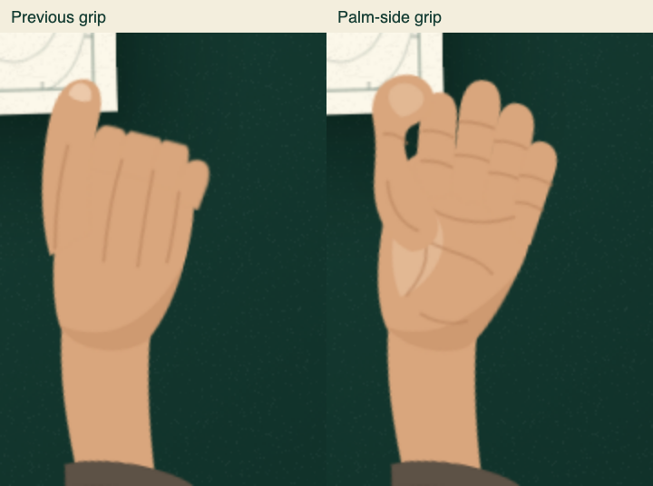

# Map opening v2 integration

Source: the supplied `HANDOFF.md` and `map-opening-prototype-v2.zip`.
The supplied map print and sampled motion are preserved. Review feedback revises
the hands to a palm-side grip and replaces the solid green cover band with
parchment and fold creases; the remaining ten WebPs stay byte-for-byte unchanged. The greeting is shared with `content/trailhead.ts`; lettering is
regenerated from the Waypoint registry and uses self-hosted Newsreader/Manrope.

## Production integration

- First visits land in List View; repeat sessions, deep links, standalone routes,
  no JavaScript, and blocked storage retain the previous gate behavior.
- CSS owns the 4400 ms opening clock and independent exit. The controller waits
  up to 1400 ms for the real heading to have layout, remeasures after font load,
  and synchronizes measured effects to that same CSS clock.
- Paper uses word spans for the ink reveal. The final page copy uses plain text
  and unitless leading copied from the real heading: inline-block word metrics
  and rounded pixel leading otherwise cause a visible swap with Newsreader.
- The real heading stays hidden through 3960 ms, and the page copy disappears on
  that exact frame. There is no whole-overlay fade or text filter.
- List-to-Climb switches under paper at 380 ms. The header remains above the
  overlay, the initiating input is excluded, and the mountain only translates.
- Controllers own their timers, input listeners, animation frames, and script
  animations. Completion, interruption, view reversal, hash navigation,
  enhancement failure, and unmount all release those resources.
- Reduced motion uses a 1400 ms still opening and 320 ms opacity-only entrance.
  Pointer, key, wheel, touch, resize and enabling reduced motion dismiss the
  active sequence. Climb-to-List remains immediate.

## Validation

The opening and transition acceptance tests cover desktop/mobile, both themes,
heading geometry and pixel equality across 3955–3965 ms, normal completion,
input dismissal, session/deep-link gates, no JavaScript, failed hydration,
blocked storage, stalled clocks, missing APIs, partial animation failure,
late heading layout, focus, and rapid reversal.

The full local Chromium/WebKit suite passed 499 tests (two unsupported native
audio cases skipped). Linux CI passed the opening/transition and visual checks
in all three browsers, including Firefox. Firefox's local binary cannot start
("Could not find profile folder"). Current CI results are recorded on the PR.

### WebKit capture limitation

The macOS Playwright WebKit screenshot path flattens 3D layers: a standalone
600×600 CSS perspective demo reproduces the same affine-looking output while
its projected DOM rectangles match Chromium. This is consistent with the
[WebKit snapshot limitation](https://bugs.webkit.org/show_bug.cgi?id=68276) and
[Playwright’s software snapshot path](https://github.com/microsoft/playwright/issues/42885).
The authored nested transforms and native back-face culling are preserved; no
production CSS workaround is added to compensate for screenshots. Chromium
checks front-face paint; all engines check projected fold geometry, timing,
heading pixels, input and cleanup. An on-screen Safari inspection could not be
captured because Computer Use access to the Playwright app was not enabled.

`npm run splash:rasterize` was also executed successfully: twelve shape-only
WebPs were generated (444,898 bytes using Chromium's WebP encoder). The initial integration kept
the supplied twelve WebPs (415 KB), whose Pillow encoding differs slightly.
The subsequent cover revision regenerates only the two cover sprites.
Regeneration changes the encoding, not the authored map geometry.

## Review frames

The Chromium captures below use the production typography and the actual
controller clock, paused at the labeled times.

Validation runs: [full Linux verification](https://github.com/FastMartini/portfolio/actions/runs/42776914782)
and [three-browser opening/transition and baseline verification](https://github.com/FastMartini/portfolio/actions/runs/42776866582).
The hand/cover revision passed the focused local opening/transition suite: 96
tests, plus typecheck and lint. CI reruns on the revised artwork commit.

## Hand and cover revision

The hands now show the palm side, four distinct curled fingers without the old
stub clipping path, rounded thumb pads and palm creases. Wrist, sleeve, grip
placement and motion timing stay the same. The cover keeps its existing title,
mountain illustration, copper accents and layout, replacing only the solid green
band with parchment and adding straight paper-fold scores. Existing hinge and
half-fold creases are more visible during unfolding.

Validation compares the generated inside-map and legend SVG against the prior
commit and hashes all ten non-cover sprites: all are unchanged. Only
`cover-wide.webp` and `cover-tall.webp` are regenerated. The printed cover labels
use dark ink for readability on the new pale background.

