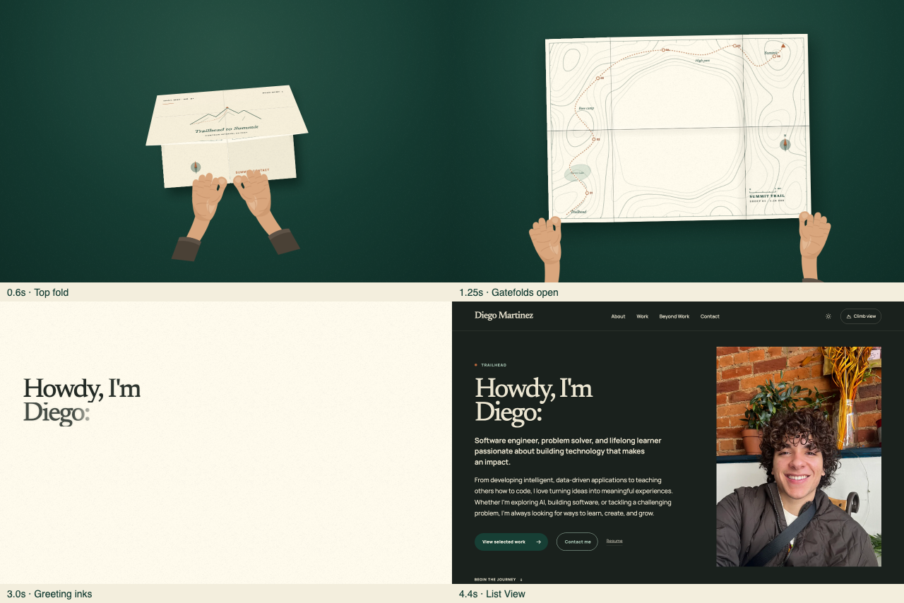
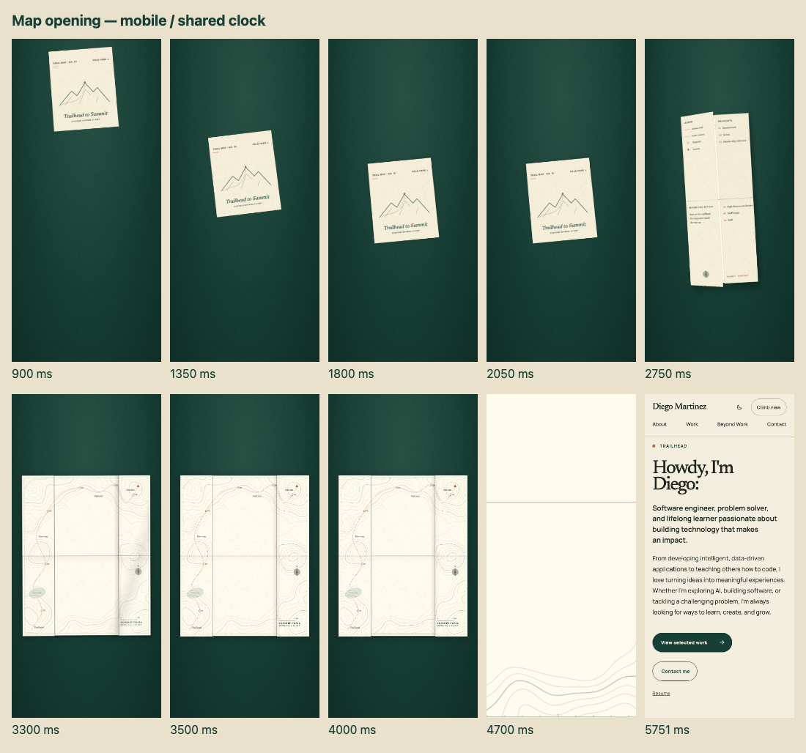
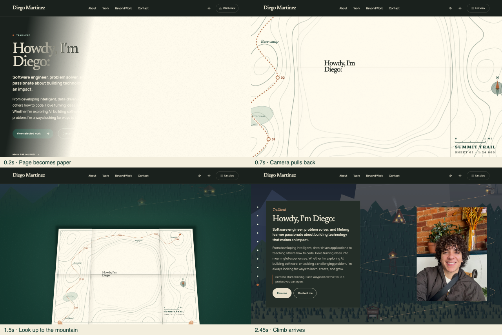
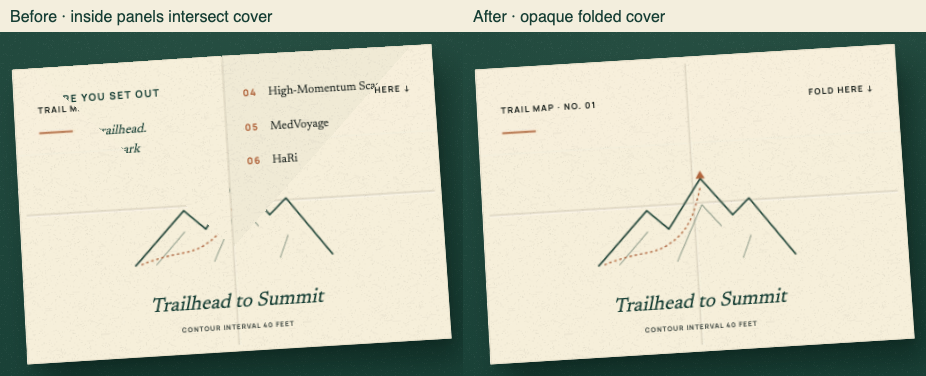
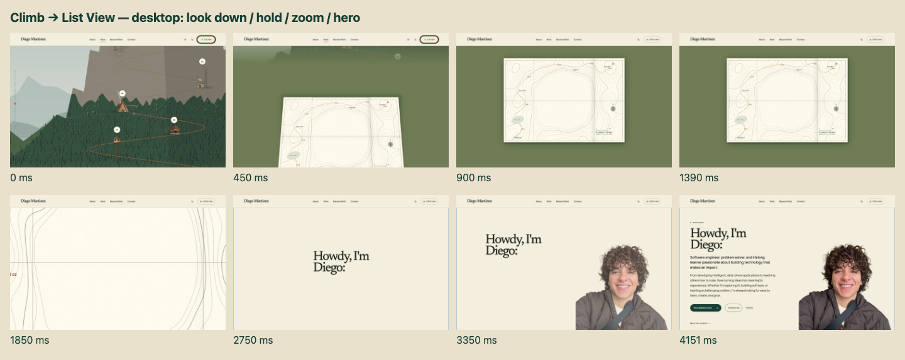
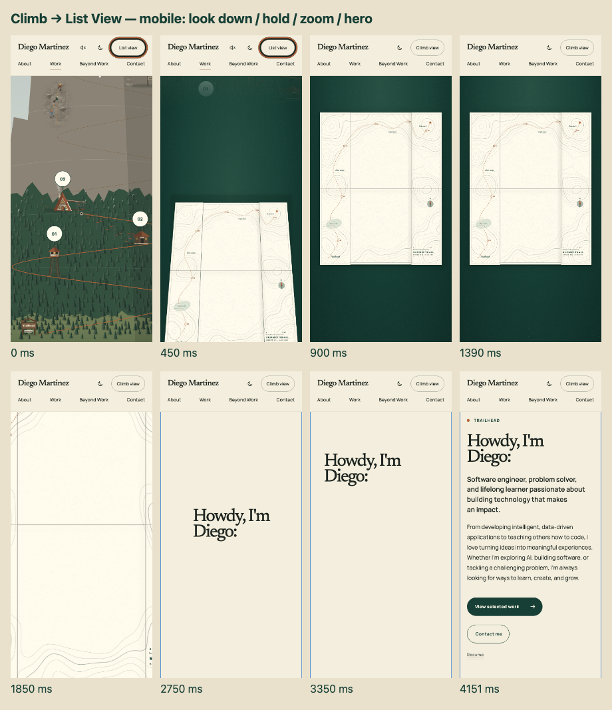

# Map opening v2 integration

Source: the supplied `HANDOFF.md` and `map-opening-prototype-v2.zip`.
The supplied map print and fold shapes are retained; timing is refined below. The opening and
List-to-Climb transition now show only the unfolding map, with all hand artwork
and hand-specific animation removed. The parchment cover and clear crease
lines from the prior revision remain. The greeting is shared with `content/trailhead.ts`; lettering is
regenerated from the Waypoint registry and uses self-hosted Newsreader/Manrope.

## Production integration

- First visits land in List View; repeat sessions, deep links, standalone routes,
  no JavaScript, and blocked storage retain the previous gate behavior.
- `components/splash/timing.json` is shared by the CSS generator and controller:
  1800 ms drift, 250 ms settled pause, 1450 ms unfold, 550 ms full-open hold,
  950 ms expansion, 1800 ms reveal (6800 ms of motion in total).
- The map's fold curves retain their resistance and soft overshoot, fitted to
  the new unfold interval. Artwork is unchanged. The camera stays still during
  the full-open hold; crease shading and grain remain visible.
- One CSS paper effect replaces overlapping opacity effects. Paper is fully
  opaque at 4980 ms, before the world hides at 5000 ms, and matches the actual
  homepage backing color before fading. The root exits at 6800 ms.
- Opening uses the actual heading from its first appearance. It fades in at
  5000 ms at the viewport center, stays visible during its glide, and supporting
  content follows through 6800 ms.
  Decorative type copies remain exclusively for the separate Climb transition.
- Cold loads wait for heading layout, fonts, and portrait decode, with a bounded
  three-second readiness budget. A slow load holds the settled map on the same
  clock. Late hydration never rewinds or re-hides an already visible hero.
- Effect disposal releases resources without dismissing/restarting CSS, so
  React's development setup/cleanup/setup does not replay the intro.
- List-to-Climb switches under paper at 380 ms. The header remains above the
  overlay, the initiating input is excluded, and the mountain only translates.
- Controllers own their timers, input listeners, animation frames, and script
  animations. Completion, interruption, view reversal, hash navigation,
  enhancement failure, and unmount all release those resources.
- Reduced motion bypasses the opening before paint and retains a 320 ms opacity-only Climb entrance.
  Pointer, key, wheel, touch, resize and enabling reduced motion dismiss the
  active sequence. Climb-to-List switches directly with reduced motion; normal
  motion uses the look-down sequence described below.

## Validation

The focused acceptance tests cover desktop/mobile, both themes, a stationary
550 ms full-open map, paper coverage across the world exit, headline-first
stagger, unchanged headline pixels across overlay cleanup, and natural cold
loads with delayed fonts/scripts. They also cover session/deep-link gates,
reduced motion without hydration, input dismissal, no JavaScript, failed
hydration, blocked storage, stalled clocks, missing APIs, partial animation
failure, late heading layout, focus, rapid reversal and Climb completion.

The earlier integration passed the full local Chromium/WebKit suite and Linux
CI in all three engines. Current revision results are recorded below and on
PR #34; those earlier full-suite results do not validate the new pacing.

### WebKit capture limitation

The macOS Playwright WebKit screenshot path flattens 3D layers: a standalone
600×600 CSS perspective demo reproduces the same affine-looking output while
its projected DOM rectangles match Chromium. This is consistent with the
[WebKit snapshot limitation](https://bugs.webkit.org/show_bug.cgi?id=68276) and
[Playwright’s software snapshot path](https://github.com/microsoft/playwright/issues/42885).
The authored nested transforms and native back-face culling are preserved; no
production CSS workaround is added to compensate for screenshots. Chromium
checks front-face paint; all engines check projected fold geometry, timing,
heading pixels, input and cleanup. An on-screen Safari inspection could not be
captured because Computer Use access to the Playwright app was not enabled.

`npm run splash:rasterize` was also executed successfully: twelve shape-only
WebPs were generated (444,898 bytes using Chromium's WebP encoder). The initial integration kept
the supplied twelve WebPs (415 KB), whose Pillow encoding differs slightly.
The subsequent cover revision regenerates only the two cover sprites.
Regeneration changes the encoding, not the authored map geometry.

## Review frames

The Chromium captures below use the production typography and the actual
controller clock, paused at the labeled times. The updated opening frames show
the hold, expansion and actual-heading reveal on desktop and mobile.

Validation runs: [full Linux verification](https://github.com/FastMartini/portfolio/actions/runs/42776914782)
and [three-browser opening/transition and baseline verification](https://github.com/FastMartini/portfolio/actions/runs/42776866582).
The current revision is checked with the focused opening/transition suite,
typecheck and lint. CI reruns on the updated PR.

## Map-only revision

The hands are removed from the shared overlay, artwork generator, styles,
motion generator and transition controller. The map unfolds by itself in both
sequences. The twelve WebPs and map geometry remained unchanged by the
hand-removal revision. The subsequent pacing revision changes timing and
removes the opening greeting swap.

The prior green-band removal and crease enhancement are retained. The cover
keeps its title, mountain illustration, copper accents and layout. Cover-only
edits can use `npm run splash:rasterize -- --covers-only` to preserve the ten
other sprites.

## Folded-cover occlusion fix

The gatefolds previously rested at 177°. Their raised corners physically
intersected the cover, exposing inside legends and cutting through its mountain
illustration. Both gatefolds now rest flat at 180° until their existing opening
cues. Their shadow ramp starts from the same closed angle. The occlusion fix
changed no printed artwork or raster assets; the later pacing refinement
retimes the same fold shapes.

The regression compares the folded cover with a reference capture of that same
cover with its concealed panels hidden. It checks cream pixels away from
antialiased edges on desktop and phone. Original samples were at 0, 350, 450
and 535 ms. The feather-entry revision samples the settled cover at 1800 and
2050 ms, then corresponding early-fold poses at 2325 and 2469 ms. The old version
failed at 0 ms with 1,867 incorrect desktop pixels and 305 phone pixels; the fixed
version reports zero at every sampled frame. WebKit's software 3D snapshots are
excluded from this paint assertion; its geometry and lifecycle checks remain.

After the fix, the focused opening/transition suite passed 98 tests, with the two
WebKit 3D paint captures skipped as described above. Typecheck and lint passed.

## Pacing and flicker diagnosis

The original camera push began at 1550 ms, before the sheet finished settling
around 1800 ms, and provided no full-open hold. A paused-frame repro showed
camera scale 1 at 1450 ms and 4.31 at 2090 ms. The current feather-entry sequence stays at
scale 1 with flat folds throughout 3500–4050 ms.

The old handoff involved two decorative greetings and the real heading, plus
two CSS paper-opacity effects and an additional scripted fade/mask. The paper
began handing off at 3420 ms while the final word's ink mask was still settling
until 3440 ms; the real heading remained hidden until 3960 ms. The refinement
removes the opening text swaps and competing effects rather than adjusting
their overlap. One paper effect covers the map until the page surface matches,
and the actual heading's opacity increases once and never decreases.

A delayed-script cold-load probe observed one CSS start, so a restart was not
reproduced as the primary cause. Disposal now preserves the CSS clock, framing
is measured only once after readiness, and completed intros cannot replay.

### Current verification

- Chromium/WebKit: 106 focused opening/transition cases pass across the suite
  and affected-test reruns; the two WebKit 3D paint captures remain skipped.
- All four natural delayed-asset cold-load cases pass in each engine: desktop
  and mobile, Light and Dark. The heading never loses opacity once it appears,
  the root clock starts once, and paper covers the map-to-page boundary.
- All four full-open hold/stagger cases pass. The overlay-cleanup pixel checks
  retain the actual heading unchanged in both themes and viewport sizes.
- Both Chromium opaque-cover checks pass at all sampled poses. The comparison
  allows a two-pixel reference neighborhood for cover glyph re-rasterization:
  old Linux CI captures change from 31 desktop/36 phone false positives to zero.
  A negative control restoring the original 177° doors still fails with 1,630
  pixels, so the test continues to detect actual inside-print bleed-through.
- Production static-export builds, TypeScript, ESLint and `git diff --check`
  pass. Updated desktop/mobile review captures show the final sequence.
- Full Linux CI reruns when PR #34 is updated; the local checks above do not
  claim that the pending full run has passed.

## Climb-to-List return

The return reuses the opening's complete map markup, paper palette, camera
framing/easing, and headline-first hero reveal. It starts with the rows and
both gatefolds already flat; the whole sheet tilts into view without unfolding.

| Phase | Time | Behavior |
| --- | --- | --- |
| Look down | 0–900 ms | Mountain moves upward while the open map and green floor rise from below; map tilt settles from 58° to overhead. |
| Hold | 900–1400 ms | Camera scale 1, map centered at 50%/50%, flat folds, visible grain/creases. |
| Zoom | 1400–2350 ms | Same measured center-pane push/easing as the opening. |
| Paper takeover | 2050–2330 ms | One opacity/color effect covers the map and matches the selected List View surface. |
| Hero | 2350–4150 ms | Actual headline holds at center, glides into place, then supporting content arrives. |

The green floor fully covers the viewport before the view changes at 900 ms.
The List View scroll and native fragment target reset under that cover. The
paper is fully opaque 20 ms before the map world is hidden; it then lifts over
the ready page, with no text clone or heading swap. The selected theme remains
intact: cream paper hands off to cream in Light mode and the matching reading
surface in Dark mode. Navigation stays above the overlay and remains usable.

A temporary backing color matches the current sky behind the moving mountain;
contact shadows gather as the map flattens, avoiding an early dark rectangle.
The same lifecycle owns both view-transition clocks and releases every effect
on completion, input, resize, motion changes, fragment navigation or reversal.
Unsupported animation APIs switch directly. Reduced motion creates no return
overlay or hero animation. Scene-recovery navigation remains immediate.

Returning always lands at the List View Trailhead, including from an open
Waypoint Panel or a previous inline Case Study. The previous Climb scroll
position is retained when visitors switch back.

### Return validation

- Broader production-export checks: **212 passed**, two known WebKit 3D paint
  captures skipped. This includes the opening, both view directions, shared
  navigation, Climb behavior and theme integration in Chromium/WebKit.
- After the final shadow adjustment, **32 return checks passed** across both
  engines. Desktop/mobile and both themes cover the flat-map start, simultaneous
  tilt/arrival, centered 500 ms hold, zoom, opaque paper handoff, headline-first
  reveal, cleanup, input interruption, reversal, fragment navigation, reduced
  motion, camera API failure and an open Waypoint Panel/previous Case Study.
- **20 targeted fallback/cold-load checks passed** after guarding the prepaint
  motion query against missing/throwing APIs. Homepage and deep-link reading
  remain usable. Natural frame sampling checks observed-frame continuity, with
  deterministic pose tests asserting exact timing independently of CI FPS.
- Static-export builds, typecheck, lint and diff checks pass. The twelve map
  raster assets are unchanged. Desktop/mobile captures above show the final
  shadow treatment. Full Linux CI reruns on the updated PR.

## Feather entry for the initial splash

Only the initial opening gains a descent. A new parent transform carries the
same folded paper, printed faces and crease geometry from above the viewport
into the center over 1800 ms. Side-to-side sway and a small rotation ease to
rest. The contact shadow gathers near the landing, rather than falling ahead
of the paper. The folded map pauses for 250 ms before the authored fold curves
begin their 1450 ms sequence. The full-open hold is 550 ms; the existing zoom,
paper handoff and hero stagger follow without replacing the map DOM.

| Initial opening phase | Time |
| --- | --- |
| Drift from above the top edge | 0–1800 ms |
| Folded map rests in the center | 1800–2050 ms |
| Unfold and settle along the existing creases | 2050–3500 ms |
| Fully opened map holds | 3500–4050 ms |
| Existing camera push | 4050–5000 ms |
| Centered greeting and shared hero reveal | 5000–6800 ms |

The prepaint gate decodes the current aspect ratio's cover, continuous map
print, four panel-back textures and grain before the descent. It also waits
for layout and the lettering fonts. During loading, all opening CSS clocks,
including pseudo-elements, hold at zero with the paper above the viewport.
A bounded eight-second load deadline or decode failure reveals the homepage
instead of showing partial artwork. This bootstrap works without hydration;
the CSS opening still exits independently once the print is ready. Reduced
motion, deep links and repeat visits bypass the loading gate and opening.

The controller aligns live CSS and measured effects to one start time after
readiness. The background sprites, live lettering and cropped print positions
stay attached to their original faces throughout flight, unfolding and zoom.
All twelve production raster assets remain byte-for-byte unchanged.

Both view transitions freeze the new entrance at its finished pose before
playing, so their existing look-up/look-down timings remain unchanged. The
new acceptance checks cover offscreen start, visible downward movement and
sway, folded panels through the landing, centered rest, unchanged map node,
delayed texture readiness, texture failure and the existing continuous handoff.

### Feather-entry validation

The focused Chromium/WebKit run passed 151 cases with two known WebKit 3D
paint captures skipped. One rapid-reversal assertion missed the temporary
forward overlay after Climb View had already appeared. Reusing the existing
activation-task pause makes that inspection deterministic; both engine reruns
pass. This verifies all 152 applicable opening/view-transition cases.

Cold-load checks include delayed fonts/scripts and delayed map textures on
desktop and mobile. They assert that the paper remains above the viewport while
textures decode, then descends with its print ready; the same map node survives
flight and unfolding. Landing, sway, folded-panel angles, centered pause,
full-open hold and continuous hero cleanup pass. A texture failure reveals the
homepage directly. Both view directions retain their original timing and
interruption behavior. Production static exports, typecheck, lint and diff
checks pass; full Linux CI reruns on the updated PR.

## Centered greeting and integrated portrait

Both entry paths call the same hero reveal, with these offsets from the end
of the paper zoom (5000 ms for the opening, 2350 ms for Climb-to-List):

| Phase | Relative time |
| --- | --- |
| Real heading fades in at the center | 0–280 ms |
| Fully readable centered hold | 280–600 ms |
| Same heading glides into its layout position | 600–1450 ms |
| Desktop portrait fades and rises 20 px during the glide | 680–1680 ms |
| Eyebrow, lead, intro, actions and scroll cue stagger in | 1180–1800 ms |
| Mobile portrait follows the intro copy | 1360–1800 ms |

The heading is never cloned or reparented. A text range measures the visible
words, excluding unused block width, so the greeting looks centered even
when it wraps. Only its visual translation changes; the final copy and image
slots are present from the first layout. Opacity reaches one before the hold
and stays there through glide and effect cleanup. The paper handoff retains
its original opaque-before-world-exit coverage and selected reading palette.

The desktop portrait stretches to the hero's right and bottom edges instead
of sitting inside an inset crop. Its top and left mask edges dissolve into the
page background. On mobile it fills a reserved 4:5 frame below the copy,
with a soft top edge. The responsive source sizes match the expanded frame;
the same 3:4 original files and Climb portrait are unchanged. The face stays
inside the cover crop at tested widths from 320 to 1920 px.

Reduced-motion initial visits and Climb returns show the final server-rendered
layout immediately. Dismissal, resize, reduced-motion changes, reversal and
navigation cancel both heading effects and every reveal so content remains
usable in its final position.

Updated opening and return contact sheets show both entry paths. Full final
layouts are in `hero-desktop.png` and `hero-mobile.png`.

### Greeting validation

- Opening/view-transition/portrait suite: 160 passed in Chromium and WebKit;
  two known macOS WebKit software 3D face-paint captures remain skipped.
- Additional reduced-motion initial/return checks at desktop/mobile sizes,
  reserved portrait and face crop at six widths (320–1920 px), updated local
  hero snapshots, and the existing WCAG AA scan: 17 passed.
- Both entry paths assert centered visible words and a readable hold, the same
  h1 throughout, full opacity during motion, the desktop portrait overlapping
  the glide, delayed copy, mobile stacking, unchanged reserved layout geometry,
  final position and animation cleanup. Existing cold-load checks delay fonts,
  textures and client scripts and sample heading opacity through the handoff.
- Production static-export builds, typecheck, lint and diff checks pass.

Linux Chromium hero baselines were captured on Ubuntu 24.04 from the same
source and visually inspected before updating the two committed references.
The targeted Linux capture also reproduced the older cover-check failure:
one antialiased pixel in the cover's own “01” lettering differed by 31 color
levels from its nearest reference neighbor. Replaying those exact captured
images reports one mismatch with the old 30-level ink tolerance and zero
with 32. The blank-paper comparison remains at 30, the two-pixel neighborhood
and zero-leak assertion remain intact, and restoring the original 177° fold
still produces 1803 leaking pixels in the negative control. Map artwork and
production rendering are unchanged by this test correction.

The final targeted [Ubuntu 24.04 Chromium run](https://github.com/FastMartini/portfolio/actions/runs/43113256845)
passes all 24 checks: both entry paths, centered greeting/hold/glide, desktop
and stacked layouts, reduced motion, six face crops, both refreshed hero
baselines and both cover-opacity comparisons. The temporary capture workflow
is outside the PR; the repository's full verification/deployment workflow is
unchanged. Full cross-browser CI continues separately on PR #34.

## Transparent hero portrait

List View now uses a transparent face-and-body cutout of the existing portrait,
created with the built-in image editing tool. The original Climb photo is
preserved. Alpha-capable responsive WebPs replace the List View photograph;
their pixel widths are 480, 800 and 1086, and the reserved frame and reveal
motion are unchanged. The rectangular photo's top/left masks are removed.
See `portrait-cutout.md` for the selected PNG, final prompt and export details.

The responsive image checks verify actual transparent corners and near-opaque
face/body pixels after browser decoding, including no-JavaScript visits. Existing
face-crop, layout reservation and both entry-path checks also cover the cutout.

The focused [Ubuntu Chromium cutout run](https://github.com/FastMartini/portfolio/actions/runs/43344496507)
passes all 30 checks, including actual decoded alpha, responsive downloads with
and without JavaScript, six portrait frame/face checks, original Climb photo
behavior, both hero entries, heading continuity and the updated Linux references.
The subject's generated alpha is 253/255 at sampled face/body points; background
corners are exactly zero. A test-only readiness/seek operation now freezes the
opening in one browser task so a busy renderer cannot finish the live animation
between the readiness check and the pause. Production timing is unchanged.

Local cutout checks verified all 52 selected desktop/mobile cases across Chromium
and WebKit. The initial run passed 44; the affected image-alpha assertions and
readiness/seek race were corrected, and a single-worker rerun with a larger local
time budget passed all 14 selected checks, covering all eight prior failures.
Production static-export builds, typecheck, lint and diff checks pass.

## Paper clipping and Light-first visits

The map now takes its paper color directly from the Light navigation-bar entry
in `components/theme/tokens.json`: `#f3eedd`, including when the selected theme
is Dark. The two cover sprites contain transparent print rather than a second
baked paper color. The other ten print sprites, artwork, camera paths and
opening/view-transition timing remain unchanged.

Each panel paints paper, shape-only print and live lettering inside one clipped
SVG viewport. Grain, crease shading, cast shadows and sheen remain clipped to
their receiving face. Generated facing tracks use the same fold clock to hide
away-facing surfaces, including inside gatefolds concealed by the closed cover.
The physical top fold also paints after the bottom row. This removes the
folded-cover print bleed in WebKit; the previous software-rendering skip is gone.

All front panels finish on one plane. After the last fold reaches its authored
zero-angle endpoint, a continuous paper backing seals fractional-pixel seams.
It stays hidden throughout unfolding. The outline regression constructs its
reference from visible faces alone, excluding the backing, and samples both
sides of the backing's activation boundary to detect any premature rectangle.

### Reproduction and verification

- The folded-cover comparison reproduced real print showing through paper in
  WebKit. Both desktop/mobile comparisons now pass in Chromium and WebKit with
  no skipped engine and without relaxing the existing comparison tolerances.
- A Retina-density pixel probe at 1512 × 827 reproduced 1,098 green pixels in
  Chromium and 1,079 in WebKit between fully open panels. The same probe now
  reports **zero in both engines**. Hiding decorative layers or merely removing
  the center panel's depth offset did not fix the gaps; the settled backing did.
- A separate fault-injection check removes CSS face backgrounds to model the
  reported missing-fill symptom. Previously all eight theme/viewport/engine
  combinations exposed the green floor; the SVG-owned material stays opaque.
  This injected failure is not a claim that the original large native-Chrome
  holes were reproduced naturally.
- Pixel checks cover unfolding, the open hold, zoom, and both view transitions;
  Retina cases cover both themes and mobile/desktop sizes. Existing checks
  retain heading continuity, covered view switching, reduced motion, interrupted
  transitions, delayed fonts/textures and cold loads.
- Refreshed `opening-*.png`, `return-*.png` and `map-fill-*.webm` show the current
  app only. The videos use installed Chrome with Metal rendering, a cold initial
  page, both view switches, and no page errors. No private browser UI or supplied
  recording is included.

The HTML declares Light before any script executes. The synchronous head script,
provider and controller share that default; only a valid saved manual choice
overrides it. The first five painted frames are checked with client scripts
blocked and a Dark device preference. No-JavaScript, invalid/denied storage,
manual choices, refresh and cross-tab synchronization remain covered. Saved
Dark preferences intentionally continue to restore before paint.

The six default List View visual references now depict Light. Tests that
specifically exercise Dark select it explicitly, and Waypoint Panel/embedded
Case Study accessibility is checked in both themes.

The targeted [Ubuntu 24.04 baseline run](https://github.com/FastMartini/portfolio/actions/runs/43401107506)
passes all six default List View captures. Only those six Linux references are
imported from its artifact; the workflow adjustment lives on a temporary
verification branch and does not change the PR's workflow.
