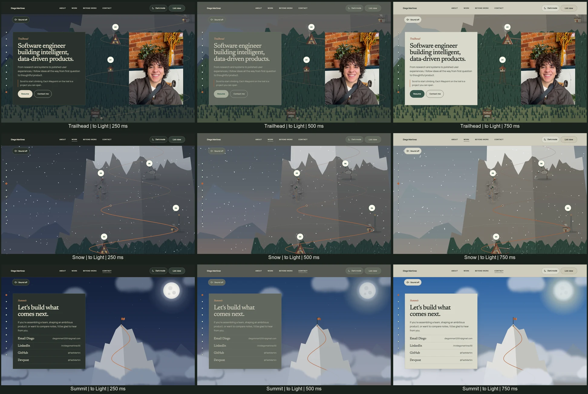
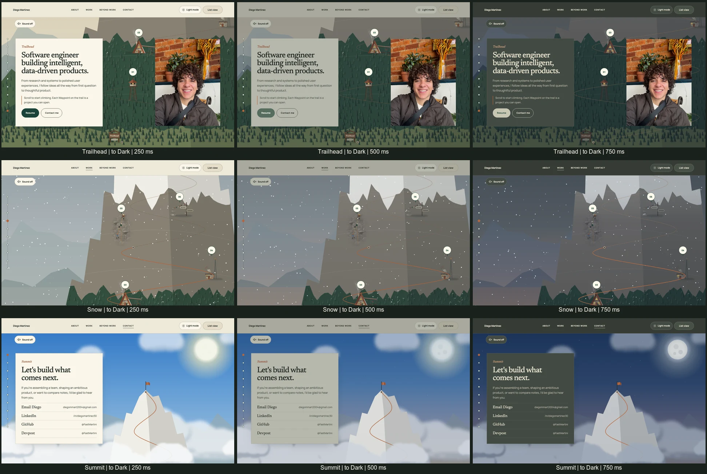

# Light/Dark implementation and validation

Canonical requirements: [issue #29](https://github.com/FastMartini/portfolio/issues/29). The approved November 6 design was supplied as `portfolio-theme-codex-handoff.zip`; its prototype defines the new colors and motion, while the existing application defines geometry, content, navigation, panels, and audio.

## Approved revisions

- Text fades continuously in OKLab over roughly 160 ms around each ink's own crossover. The approved design accepts brief intermediate contrast below 3:1, approximately 70 ms for primary text and up to 135 ms for quieter labels in the prototype. Endpoint accessibility checks do not establish continuous contrast compliance.
- The moon shares the sun's 22rem box, anchor, transform, and approximately 110px disc. Both remain stationary and crossfade.
- All four Climb cards use the raised surface: cream in Light and dark green in Dark. Deliberately dark List View and Case Study sections retain their separate treatment.

## Ownership and rendering

The root layout restores the saved selection synchronously before content paints. One client controller owns the destination, current phase, motion preference, persistence, and tab synchronization. Route changes settle at the selected destination; List/Climb switches preserve the current phase.

Both settled and animated UI palettes are scoped to `data-theme-root` surfaces. This is an intentional refinement of the supplied reference: changing inherited root palette variables caused expensive SVG invalidation even though those variables were only used by the interface. [ADR 0005](../adr/0005-scope-theme-palettes-to-ui-roots.md) records that boundary.

The existing Climb frame path is the sole environment writer. Theme subscriptions request frames; scroll determines altitude. Theme-only frames retain navigation geometry. The environment updates sky-local values, cloud groups, far ranges, veil and light opacity, and snowfall tint. The original vector nodes, depth ordering, camera interaction, and SMIL timelines remain live.

Landmark builders emit warm light copies at build time, using the original animation markup. The night-light group is one isolated paint layer; it is not cloned or rebuilt during interaction. Original daytime artwork remains covered by existing reference and deterministic scenery checks.

`components/theme/tokens.json` supplies both the transition colors and generated settled stylesheet. After changing approved token values, run `npm run theme:generate`. Static control and backing styles live separately from generated values.

## Baseline before implementation

The immutable baseline was current `main`, commit `aaa198f`, containing the merged GPU-cache fix.

- Existing suite: 265 Chromium tests and 117 applicable WebKit tests passed; two engine-specific skips. Four pure tests passed under the Firefox project, but all 113 Firefox browser tests failed to launch with “Could not find profile folder,” before loading the application.
- Visible installed Chrome, native full-route scroll in both directions: normal-memory and 128 MB GPU-constrained checks passed independently, each requiring zero exposed-backing frames and exact rendered endpoints.
- A fresh Firefox installation reproduced the local profile error, including an OS sandbox-extension permission failure. Linux CI is required for actual Firefox browser evidence on this machine.

## Acceptance evidence

The production export is tested through the existing Playwright server with `/portfolio/` as its deployment base path. Browser-suite results are finalized below after the current runs complete.

| Surface / behavior | Coverage |
| --- | --- |
| List View | Both themes, semantic surfaces, deliberate dark sections, endpoint axe checks |
| Climb | Both themes; all ten stops; cream/dark cards; night lights, veil, clouds, snow and summit moon |
| Waypoint Panel | Both themes; toggling with the panel open preserves reading position and closing focus |
| Case Study | All three standalone routes in both themes; shared header and embedded reading surfaces |
| Persistence | First visit under both OS preferences; saved themes before first paint; refresh mid-change; invalid/denied storage; same-origin tabs without write-back |
| Interruption | Rapid reversals; List/Climb switches mid-change; hidden document; route navigation; live motion-preference changes |
| Reduced motion | Short linear fade; no twilight; existing List startup, paused SMIL and disabled snow policies retained |
| Responsive / input | 320, 390 and 1280px control checks; 390 and 1440px Climb snapshots; keyboard traversal, 44px targets and no horizontal overflow |
| Fallback | Missing animation-frame or mutation-observer support leaves server reading content and manual theme selection usable |

### Visual review

The reviewed endpoint snapshots cover Trailhead, Waypoints 03 and 06, and Summit at desktop/mobile sizes in both themes. Existing Dark List View baselines change only around the new header control. Original daytime vector comparisons remain strict: tests exclude only the added night nodes and semantic class hooks.

The following boards capture the actual production application at 250, 500 and 750ms. Rows are Trailhead, snow stage and Summit; columns are elapsed time. The browser clock advances at 60Hz and SMIL is fixed at time zero for visual comparison. This is controlled-time visual evidence, separate from native moving-paint evidence. [Frame measurements](theme-evidence/transition-frames.json) record the rendered colors and opacities.

### Native moving-paint validation

Installed visible Chrome **156.0.8078.81**, physical content area **1200 × 760**, **DPR 2**. Each run scrolls the complete route forward and backward, toggles the theme while moving, and asserts settled rendered positions `0.0000 → 1.0000 → 0.0000`.

| GPU memory | Starting theme | Repetitions | Captured frames | Exposed-backing frames |
| --- | --- | ---: | ---: | ---: |
| Normal | Dark | 1 | 340 | 0 |
| Normal | Light | 1 | 364 | 0 |
| Artificial 128MB limit | Dark | 3 | 1,108 | 0 |
| Artificial 128MB limit | Light | 3 | 1,089 | 0 |
| Total | Both | 8 | 2,901 | 0 |

[Per-run measurements](theme-evidence/gpu-scroll.json) include endpoint observations, viewport, capture time and analysis time. Every captured frame was decoded and inspected. The JPEG decoder and pixel oracle have explicit exposed/opaque controls; the zero-missing threshold and full-route assertions remain unchanged. This detects exposed backing, not every possible visual artifact. Native paint tests and controlled-time continuity checks complement one another.

### Limits and accepted compromises

- Mobile results are viewport emulation. No physical iPhone or Android phone was available; phone GPU/display behavior and dim-screen forest legibility remain unverified.
- Local Firefox cannot create its profile, including with a fresh browser install. Linux CI supplies the actual Firefox application checks; the local launch error is not counted as a product failure or a pass.
- The approved continuous text fade briefly lowers intermediate contrast. Endpoint axe passes do not imply full-transition WCAG contrast compliance.
- The approved hill clip can tint a thin strip above foreground hill crests, and a few edge-tree slivers can retain daytime color. These remain the supplied design's known compromises.
- WebKit means Playwright's WebKit engine, not a physical iOS Safari device. GPU cache stress is Chromium-specific; the other engines run applicable rendering, motion, fallback and interaction checks.

## Reproduction

Use the existing Playwright production-export boundary, including the configured deployment base path. Run `npm run lint`, `npm run typecheck`, and `npm test`. The `theme.spec.ts` suite is included in Chromium, Firefox, and WebKit selections and exercises the real theme control, first paint, persistence, interruptions, panels, reading routes, tab synchronization, reduced motion, accessibility, and responsive controls.

The existing GPU-cache protocol remains the rendering gate. Evaluate normal memory separately from the artificial constraint and capture moving frames, not only endpoints. The backing-color oracle detects missing paint; separate transition captures assess continuity and intermediate appearance.
